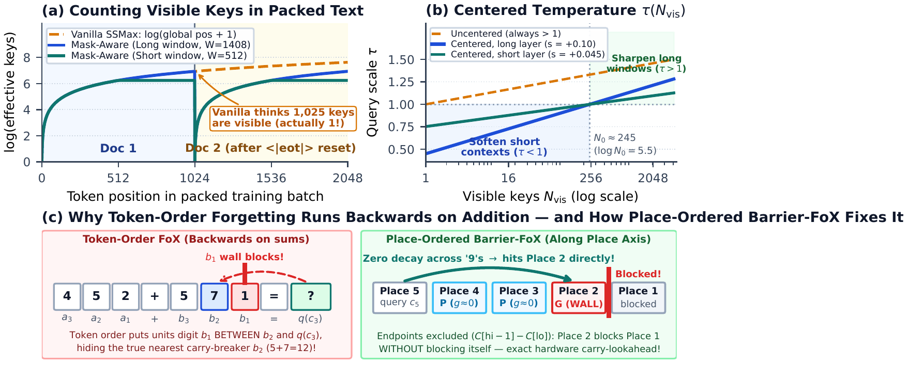
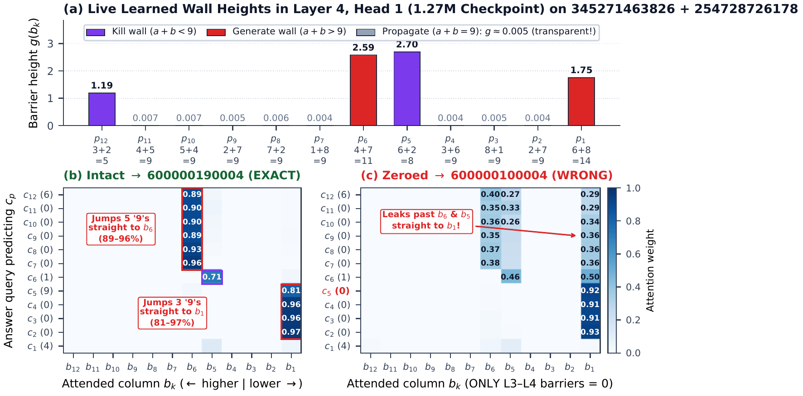
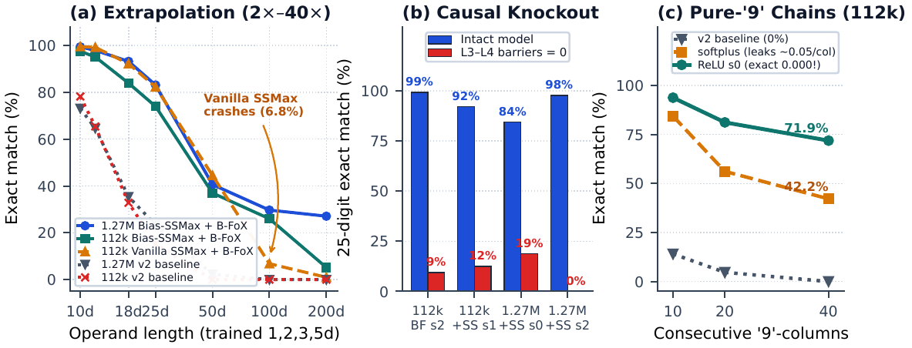
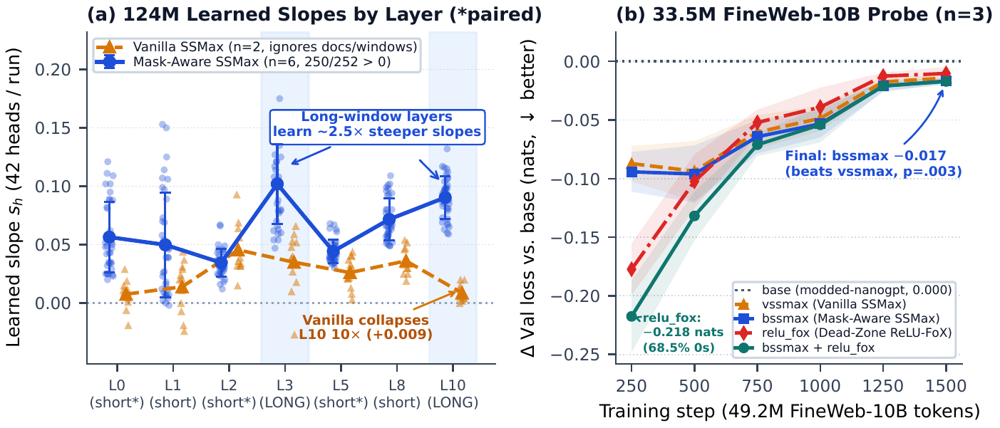
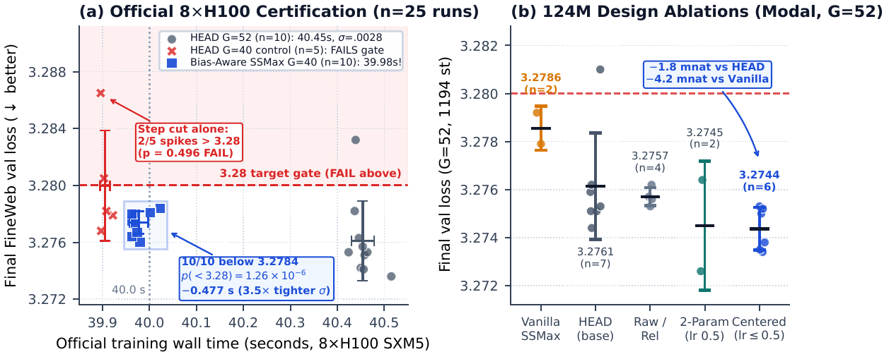

# Improving Out-of-Distribution Generalization with Bias-Aware Softmax Scaling and Barrier-FoX

**From 200-Digit Arithmetic Circuits to Sub-40s 8×H100 LLM Training**

**Author:** Felipe Sens Bonetto (`felipesensbonetto@gmail.com`)  
**Paper:** [Read the full 10-page paper (`paper/main.pdf`)](paper/main.pdf) · [LaTeX source (`paper/main.tex`)](paper/main.tex)

---

## Plain-English Summary

Self-attention has two simple, fixable blind spots when sequence lengths change or hard boundaries appear:

1. **Attention does not know how many keys it can actually see.** Under QK-RMSNorm, dot products are norm-capped, so more tokens dilute softmax weights. Prior fixes (Scalable-Softmax / SSMax) sharpen every query using $\log(\text{position} + 1)$ — assuming *every* earlier token is visible. On packed batches with `<|endoftext|>` document resets, sliding windows, or decay masks, that count is wrong and over-sharpens truncated heads.  
   **Fix — Bias-Aware SSMax:** Count only the keys that *survive* the mask or additive bias, center the curve around a neutral length ($\log N_0 = 5.5$) so short contexts can stay soft while long windows sharpen, and initialize at exact identity ($\tau = 1$). On modern LLMs with hard document and sliding-window masks, it collapses to an exact $O(T)$ count with zero attention-kernel changes and just **+1 scalar per head**:

```math
N_{\mathrm{vis}}(t, \ell) = \min\bigl(\mathrm{pos}(t),\ W_\ell\bigr), \qquad \tau_{\ell,h}(t) = \max\Bigl(0.25,\ 1 + s_{\ell,h}\bigl(\log N_{\mathrm{vis}}(t, \ell) - 5.5\bigr)\Bigr)
```

2. **Fixed distance decay cannot act like a switch.** Static penalties (like ALiBi) decay smoothly with distance, so a head cannot pass an unbroken chain of carry-propagating digits ($a_k + b_k = 9$) with zero loss while blocking everything past the first carry-breaker ($a_k + b_k \neq 9$). Learned forget gates (FoX) can act like walls, but token-order accumulation runs *backwards* on left-to-right addition.  
   **Fix — Place-Ordered Barrier-FoX (+ Dead-Zone ReLU):** Let each token emit a non-negative wall height $g \ge 0$ accumulated strictly along the causal axis of interest (digit place order for arithmetic; token order with a dead-zone $\operatorname{ReLU}$ gate for general sequences), excluding both endpoints so a wall blocks everything behind it without blocking itself.



---

## Mechanistic Interpretability & Headline Results

### 1. Emergent Hardware Carry-Lookahead & 40× Addition Extrapolation (`112k` & `1.27M`)

Trained exclusively on **1, 2, 3, and 5-digit sums** (4-digit held out completely), all **9 out of 9** independently trained `Barrier-FoX` seeds spontaneously invent exact hardware carry-lookahead walls inside Layers 3–4: *Kill* ($a_k+b_k < 9$) and *Generate* ($a_k+b_k > 9$) columns emit sharp walls (`1.19–2.70`), while *Propagate* ($a_k+b_k = 9$) columns stay transparent (`0.004–0.007`).



- **Extrapolation (`25d` = 5× to `200d` = 40×):** Combining Bias-Aware SSMax + Barrier-FoX lifts 25-digit exact match by **+58.6pp** at `112k` (`15.3% → 74.0%`, $p = 0.0157$) and **+59.7pp** at `1.27M` (`23.4% → 83.1%`, $p = 0.0145$), reaching **81.2% at 200 digits (40×)** on `1.27M s0`. Bias-blind Vanilla SSMax over-sharpens and crashes from `44.5%` (50d) to `6.8%` (100d, `3.8×` worse).
- **Causal knockout:** Zeroing *only* Layer 3–4 barrier weights collapses 25-digit accuracy by **53–98pp** (`1.27M s2`: `97.7% → 0.0%`).
- **Dead-zone ReLU fix:** On adversarial 40-digit pure-`9` chains, strictly positive `softplus` leaks $\sim 0.05$ logits/col (`42.2%`); dead-zone `ReLU` drives four carry heads to literal `0.000` on 100% of Propagate columns and jumps to **71.9%**.



### 2. Generalization Without Digit Formulas: Multi-Step Symbolic Algebra (`447k`)

On canonical step-by-step exact-rational expression rewriting (`+`, `-`, `*`, `/`, parentheses; zero digit formulas), general causal `NeoExprGPT` (`NoPE + Token-FoX + Causal Depth + Bias-Aware SSMax`) beats matched `RoPE GPT` (`445k`) on every OOD split at full 18k convergence:
- **2× longer traces (`ood_steps`):** **3.7×** exact match (`15.3%` vs. `4.2%`), **+17.2pp** token accuracy (`96.4%` vs. `79.2%`, paired $p = 0.0033$).
- **Unseen nesting depth (`ood_depth`):** **+14.6pp** exact match (`43.1%` vs. `28.5%`, 100% trace-verified), **+7.1pp** token accuracy ($p = 0.0038$).

### 3. Opening the 124M LLM & Sub-40s `8×H100` `modded-nanogpt` Certification

- **33.5M FineWeb-10B probe (`Modal A10G`, `n=3`):** Window/Doc-Aware `bssmax` (`+48` scalars) beats both `base` (`-0.0168` nats @ 2048, $p=0.011$; `-0.0274` @ 4096, $p=0.009$) and `vssmax` ($p=0.0030$) on 3/3 seeds. `relu_fox` self-discovers **68.5% exact-zero tokens** and drops step-250 loss by `-0.218` nats.
- **Zero-HBM-traffic Triton fusion (`124M modded-nanogpt`, Record #92 / ANVIL2):** Fusing centered Bias-Aware SSMax (`+42` fp32 scalars) into `qkv_rope.py` uses a 1-launch binary search over `cu_seqlens` and exploits RoPE's orthogonality ($\sum_d g_q \cdot y \equiv \sum_d g_{\mathrm{norm}} \cdot \hat{x}$, already in registers for QK-RMSNorm backward!) — costing only **+72 ms (+0.17%)** and **+0 MiB VRAM**.
- **124M mechanistic interpretability:** Across 6 matched-step runs, **250/252 (99.2%) heads** learn strictly positive slopes, with long-window layers (`L3: +0.102`, `L10: +0.090`) learning **~2.5× steeper curves** than short-window layers (`+0.035–0.072`), whereas Vanilla SSMax collapses `L10` 10× to `+0.009`.



- **Official bare-metal Nebius `8×H100 SXM5` certification (`10 vs 10` interleaved + `5`-run matched-step control):**

| Arm (`8× NVIDIA H100 80GB HBM3`, `NV18`) | $n$ | Steps | Wall Time | Final `val_loss` | Range | $> 3.28$ | One-sided $p(<3.28)$ |
|---|---:|---:|---:|---:|---|---:|---:|
| `HEAD` (`4ea6b93`, `G=52`, interleaved) | 10 | 1194 | `40.454 ± 0.024 s` | `3.27610 ± 0.00281` | `3.2736–3.2832` | 1 / 10 | `8.78e-4` |
| **Bias-Aware SSMax (`G=40`, this work)** | **10** | **1182** | **`39.977 ± 0.020 s`** | **`3.27738 ± 0.00079`** | **`3.2760–3.2784`** | **0 / 10** | **`1.26e-6`** (`t = -10.43`) |
| `HEAD @ G=40` (step-cut only, no SSMax) | 5 | 1182 | `39.905 ± 0.011 s` | `3.27998 ± 0.00389` | `3.2768–3.2865` | 2 / 5 | `0.496` (**FAIL**) |

Cutting 12 Stage-2 steps with centered Bias-Aware SSMax saves **−0.477 s (`40.45 s → 39.98 s`, paired $p = 7.62\times 10^{-12}$)** while collapsing run-to-run loss variance **3.5–4.9×** (`0/16` runs above `3.2784` across both clouds vs. `4/22` spikes > `3.28` for unmodified `HEAD`).



---

## Repository Structure

```text
├── paper/
│   ├── main.pdf                  # Full 10-page compiled paper
│   ├── main.tex                  # Clean LaTeX source (zero warnings)
│   ├── make_figs.py              # Reproduces all 5 vector figures from live weights & logs
│   └── fig1..fig5_*.pdf          # Publication vector figures
├── assets/                       # High-res PNG previews for README
├── neo_gpt.py, train_neo.py      # Place-Ordered Barrier-FoX, Dead-Zone ReLU, Bias-Aware SSMax
├── expr_data.py, neo_expr.py, train_expr.py  # Multi-step exact-rational rewriting benchmark
├── fineweb_probe/                # 33.5M modded-nanogpt FineWeb-10B probe scripts
├── tests/                        # Causality, shift-invariance, monotonicity, KV-cache tests
├── checkpoints/                  # Live 1.27M s1 checkpoint powering Figure 2
├── data/                         # Raw JSON/JSONL records (33.5M probe, 27 Modal + 25 Nebius runs)
└── speedrun/                     # Clean modded-nanogpt patch.diff, README, and all 25 raw H100 logs
```

---

## Quick Reproduction

```bash
# 1. Run unit tests (strict causality, place-shift invariance, monotonicity, KV-cache parity)
python3 tests/test_neo_gpt.py
python3 tests/test_expr.py

# 2. Regenerate all 5 paper figures directly from the bundled 1.27M checkpoint & raw JSONL logs (CPU, ~3s)
python3 paper/make_figs.py

# 3. Train skip-4 addition (1,2,3,5d -> 200d extrapolation)
python3 train_neo.py --name neo_v2_bssmax_bfox --bias_ssmax --barrier_fox --seed 0

# 4. Train multi-step exact-rational expressions (NeoExprGPT vs RoPE GPT)
python3 train_expr.py --name neo_expr --arch neo --steps 18000 --seed 0
```

See [`speedrun/README.md`](speedrun/README.md) and [`speedrun/patch.diff`](speedrun/patch.diff) for the exact `modded-nanogpt` Track 1 implementation (`+138 / -26` lines across 5 files, `0` edits to `train_gpt.py`) and all 25 raw bare-metal `8×H100 SXM5` certification logs.

## Citation

```bibtex
@misc{bonetto2026biasawaressmax,
  title  = {Improving Out-of-Distribution Generalization with Bias-Aware Softmax Scaling and Barrier-FoX: From 200-Digit Arithmetic Circuits to Sub-40s 8xH100 LLM Training},
  author = {Felipe Sens Bonetto},
  year   = {2026},
  url    = {https://github.com/FeSens/Bias-Aware-Softmax-Scaling}
}
```
